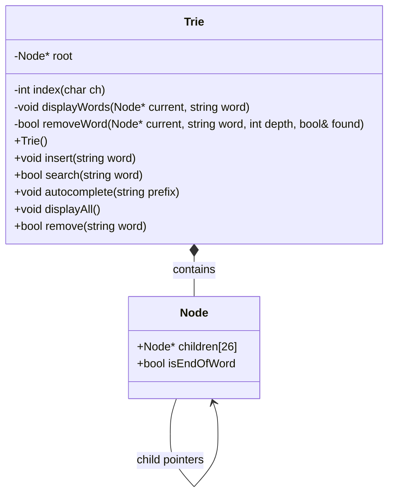
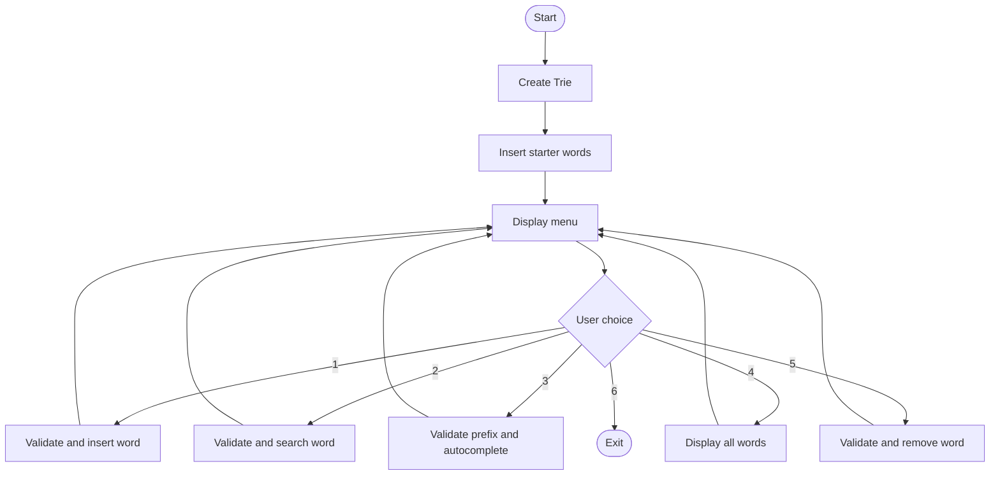

# UML and Design Documentation

## 1. System Overview

The Trie Predictive Text and Autocomplete System is a menu-based C++ application. It stores words in a Trie and provides operations for adding, searching, suggesting, displaying, and removing words.

## 2. Class Design

### Node Structure

**Attributes**
- `children[26]`: Array of pointers to child nodes representing letters a–z.
- `isEndOfWord`: Boolean indicating whether the current node completes a word.

### Trie Class

**Private attributes**
- `root`: Pointer to the root node.

**Private methods**
- `index(char ch)`: Converts a lowercase letter into an array index.
- `displayWords(Node* current, string word)`: Traverses the Trie and displays complete words.
- `removeWord(Node* current, string word, int depth, bool& found)`: Recursively removes a word and prunes unnecessary nodes.

**Public methods**
- `Trie()`: Creates the root node.
- `insert(string word)`: Inserts a word.
- `search(string word)`: Searches for an exact word.
- `autocomplete(string prefix)`: Displays words matching a prefix.
- `displayAll()`: Displays all stored words.
- `remove(string word)`: Removes a word.

### Main Function

The `main()` function initializes sample words, displays the menu, accepts the user's choice, validates input, and calls the appropriate Trie operation.

## 3. UML Class Diagram

## 4. Program Flow

## 5. Design Explanation

The `Trie` class manages the word-storage structure, while each `Node` stores character links and information about completed words. The root represents the beginning of all stored words.

The menu separates user interaction from the core Trie operations. Input normalization converts alphabetic input to lowercase and rejects empty strings or characters outside the accepted alphabet.

## 6. Relationship to Predictive Text

When a user enters a prefix, the program follows the corresponding character path. If the path exists, it traverses the remaining subtree to display words beginning with that prefix. This demonstrates the basic lookup mechanism used by autocomplete features.

## 7. Design Limitations

The implementation supports lowercase English letters after input normalization. It uses a fixed array of 26 child pointers for every node. It demonstrates prefix matching but does not rank suggestions using word frequency or contextual language predictions.
